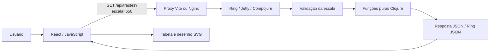

# Calculador de Trastes — Valderrama Luthier

Aplicação web para calcular posições e espaçamentos de **24 trastes**, a partir da escala do instrumento em milímetros. O frontend usa **React com JavaScript**; uma **API REST em Clojure** realiza todos os cálculos e retorna JSON.

Projeto de extensão da disciplina **Programação Funcional com Linguagem Clojure**, do Instituto Mauá de Tecnologia, com a empresa parceira **Valderrama Luthier**. Público: luthiers, músicos e estudantes interessados na construção de instrumentos de cordas com afinação temperada.

## Equipe e autoria

| Item | Informação |
| --- | --- |
| Componentes do grupo e RAs | Enzo Oliveira D'Onofrio - RA: 23.01561-6,  
Leonardo Souza Olivieri - RA: 23.01512-8 |
| Empresa parceira | Valderrama Luthier |
| Instituição | Instituto Mauá de Tecnologia |
| Disciplina | Programação Funcional com Linguagem Clojure |
| Prazo indicado na especificação | 04/11/2026, com opção de entrega em 28/10/2026 |

O roteiro da demonstração está em [docs/roteiro-video.md](docs/roteiro-video.md). A gravação e os dados de autoria devem ser finalizados pelo grupo.

## Funcionalidades

- Entrada da escala em mm, aceitando vírgula ou ponto decimal na interface.
- Cálculo dos 24 trastes, com distância à pestana, distância à ponte e espaçamento entre trastes.
- Tabela com duas casas decimais, mantendo a precisão dos resultados na API.
- Desenho SVG proporcional às posições retornadas pelo backend.
- Seleção sincronizada na tabela e no desenho, com navegação por teclado.
- Destaque do 12º traste, localizado na metade da escala.
- Validação no frontend e no backend, carregamento, timeout, tratamento de falhas e indicação de resultados anteriores após edição da escala.
- Layout responsivo, escuro, com amarelo dourado, tons de madeira e identificação textual da marca.

O desenho é ilustrativo, sem escala física para impressão. Esta versão não inclui autenticação, persistência, exportação, hospedagem pública ou integração ao site do parceiro.

## Arquitetura do sistema



O backend separa quatro responsabilidades:

- `calculator`: funções puras para a posição e as três medidas de cada traste, sem I/O ou arredondamento.
- `validation`: leitura e validação de um único parâmetro decimal finito e positivo.
- `handler`: rotas, status HTTP, mensagens em português e registro de exceções no servidor.
- `server`: configuração de host/porta e ciclo de vida do Jetty.

No frontend, `App` controla o formulário e a consulta. Os componentes `Results` e `Fretboard` exibem os dados da API. Não existe implementação paralela da fórmula no JavaScript de produção: as operações do SVG apenas convertem milímetros retornados em coordenadas visuais.

### Fluxo operacional

1. O usuário informa a distância da pestana à ponte e envia o formulário.
2. O React valida a entrada e normaliza a vírgula decimal para ponto.
3. O proxy encaminha a chamada à API Clojure.
4. O backend valida novamente, calcula os 24 trastes e serializa os números como JSON.
5. A interface formata os valores no padrão `pt-BR` e atualiza a tabela e o desenho.
6. A seleção de um traste destaca sua posição nas duas representações.

Consultas têm timeout de 12 segundos. Editar a escala durante uma consulta cancela o pedido anterior, evitando que uma resposta antiga substitua a entrada atual. Resultados existentes permanecem identificados pela escala usada até um novo cálculo.

## Fórmula e precisão

Para uma escala `L` em mm e um traste `n` de 1 a 24:

```text
d(n) = L × (1 − 1 / 2^(n/12))
distância à pestana = d(n)
distância à ponte   = L − d(n)
espaçamento        = d(n) − d(n−1), com d(0) = 0
```

Usamos `double`, expoente fracionário e **nenhum arredondamento intermediário**. Só a apresentação arredonda para duas casas decimais. O espaçamento é a distância entre posições sucessivas, e não a largura física do metal do traste.

Exemplos para **650 mm**:

| Traste | Espaçamento (mm) | Até a ponte (mm) | Até a pestana (mm) |
| ---: | ---: | ---: | ---: |
| 1 | 36,48 | 613,52 | 36,48 |
| 2 | 34,43 | 579,08 | 70,92 |
| 12 | 19,33 | 325,00 | 325,00 |
| 24 | 9,66 | 162,50 | 487,50 |

Subtrair `70,92 − 36,48` produziria `34,44`, diferente do espaçamento correto. Por isso, o backend subtrai os valores completos antes de formatar.

## Tecnologias e infraestrutura

| Camada | Tecnologias |
| --- | --- |
| Interface | React 19.3.1, JavaScript, Vite 8.3.5, CSS Modules e SVG |
| Backend | Clojure 1.12.6, Clojure CLI / `deps.edn` |
| HTTP | Ring 1.15.6, Jetty e Compojure 1.7.2 |
| JSON | Ring JSON 0.5.1 |
| Testes | `clojure.test`, Vitest 5.0.5, React Testing Library e jsdom |
| Containers | Docker Compose, Node 24.13.1 para build, Nginx 1.28.0, Java 21 no backend |

As dependências diretas estão fixadas; o frontend inclui `package-lock.json` para instalação com `npm ci`. A tipografia sem serifa tenta carregar Google Fonts e possui fallback local para Arial. Os títulos usam Georgia, com fallback serifado. A calculadora funciona sem o serviço de fontes.

Os PDFs e o XLSX originais permanecem na raiz. Código do frontend em `frontend/`, backend em `backend/`, utilitários em `scripts/` e roteiro em `docs/`.

## Instalação e execução local

### Requisitos

- Node.js **22.12 ou superior**; recomendado Node 24.
- npm, incluído no Node.js.
- Java **21 ou superior** e Clojure CLI. Não é necessário Leiningen.
- Internet na primeira instalação para baixar dependências.
- Python 3 é opcional, usado apenas nos utilitários de verificação.

Verifique o ambiente:

```sh
node --version
npm --version
java -version
clojure -Sdescribe
```

### Terminal 1: backend

A partir da raiz do projeto:

```sh
cd backend
clojure -M:run
```

API em **http://127.0.0.1:3000**. O Clojure CLI baixa as dependências automaticamente na primeira execução.

### Terminal 2: frontend

Em outro terminal, a partir da raiz:

```sh
cd frontend
npm ci
npm run dev
```

Abra **http://127.0.0.1:5173**. O Vite encaminha `/api` para `http://127.0.0.1:3000`; o navegador usa a mesma origem e não exige configuração de CORS.

### Configurações opcionais

| Variável | Padrão | Onde usar |
| --- | --- | --- |
| `HOST` | `127.0.0.1` | Backend local; o Compose define `0.0.0.0` dentro do container |
| `PORT` | `3000` | Backend |
| `API_PROXY_TARGET` | `http://127.0.0.1:3000` | Proxy do Vite em desenvolvimento |

Exemplo de portas alternativas, executando em terminais separados:

```sh
# No diretório backend
PORT=3001 clojure -M:run
```

```sh
# No diretório frontend
API_PROXY_TARGET=http://127.0.0.1:3001 npm run dev
```

### Build do frontend

```sh
cd frontend
npm run build
```

O resultado fica em `frontend/dist/`. Para executar a aplicação completa a partir desse build, use o Compose abaixo: ele inclui o proxy da API. `vite preview` isoladamente não substitui essa infraestrutura.

## Execução com Docker Compose

Requisito: Docker Desktop ou Docker Engine com Compose, em execução. Não é necessário instalar Node, Java ou Clojure no computador para esta opção.

Na raiz:

```sh
docker compose up --build -d
docker compose ps
```

Abra **http://127.0.0.1:8080**. O primeiro build baixa imagens e dependências. O frontend só inicia quando o healthcheck da API estiver saudável.

- O Nginx serve o build do React e encaminha `/api` para `backend:3000`.
- A API fica na rede interna do Compose. Para acessá-la pelo computador, use a porta **8080**, por exemplo `http://127.0.0.1:8080/api/health`.
- A porta publicada está vinculada ao loopback do computador, conforme o escopo local da entrega.

Logs e encerramento:

```sh
docker compose logs -f
```

```sh
docker compose down
```

## Endpoints da API

### `GET /api/trastes?escala=650`

`escala` deve ser um único valor numérico finito maior que zero. A API aceita ponto decimal e notação científica. Vírgula decimal é uma conveniência da interface e deve ser convertida antes da chamada HTTP.

```sh
curl -i 'http://127.0.0.1:3000/api/trastes?escala=650'
curl -i 'http://127.0.0.1:3000/api/trastes?escala=648.75'
```

HTTP `200`, `Content-Type: application/json`. Exemplo com o primeiro item; a resposta real contém **24**:

```json
{
  "escala_mm": 650.0,
  "quantidade_trastes": 24,
  "trastes": [
    {
      "numero": 1,
      "espacamento_mm": 36.481696756899204,
      "distancia_ponte_mm": 613.5183032431008,
      "distancia_pestana_mm": 36.481696756899204
    }
  ]
}
```

### `GET /api/health`

```sh
curl -i 'http://127.0.0.1:3000/api/health'
```

HTTP `200`:

```json
{"status":"ok"}
```

### Erros

| HTTP | Código JSON | Situação |
| --- | --- | --- |
| 400 | `escala_invalida` | Escala ausente, vazia, não numérica, não finita, não positiva ou repetida na query |
| 404 | `rota_nao_encontrada` | Endpoint inexistente |
| 500 | `erro_interno` | Falha inesperada; detalhes registrados apenas no servidor |

```sh
curl -i 'http://127.0.0.1:3000/api/trastes?escala=0'
```

```json
{
  "erro": {
    "codigo": "escala_invalida",
    "mensagem": "Informe uma escala numérica finita e maior que zero, em milímetros. Use ponto para decimais na API."
  }
}
```

Com Docker, substitua a porta `3000` por `8080` nos exemplos.

## Testes e validação

### Backend

```sh
cd backend
clojure -M:test
```

São verificados os 24 trastes contra referências independentes, tolerância absoluta de `10⁻⁹ mm`, pontos conhecidos, espaçamentos positivos e decrescentes, distâncias crescentes, soma das distâncias, proporcionalidade e escala decimal. Os handlers cobrem sucesso, entradas inválidas, healthcheck, 404 e 500.

O teste de 500 provoca uma exceção de propósito: um registro `SEVERE` com `Detalhe privado` é esperado no log; a resposta JSON não expõe esse detalhe. A conclusão dos testes deve indicar zero falhas e zero erros.

### Frontend

```sh
cd frontend
npm test
```

Os testes cobrem envio explícito, normalização decimal, rejeição de entradas inválidas, tabela com 24 trastes, formatação, seleção e teclado, aviso de resultado anterior, carregamento, falha de rede, erros da API, resposta inválida, cancelamento e timeout. Para acompanhar mudanças: `npm run test:watch`.

### Conferência da aplicação real

Com o Compose iniciado, na raiz:

```sh
python3 scripts/smoke_test.py
```

Para conferir o servidor de desenvolvimento e seu proxy:

```sh
python3 scripts/smoke_test.py --base-url http://127.0.0.1:5173
```

Esse utilitário verifica o HTML, healthcheck, as 72 medidas numéricas de referência, escala decimal e respostas de erro através de HTTP real.

### Origem das referências numéricas

A planilha original não possui resultados numéricos em cache. O utilitário abaixo lê seu XML, confirma as fórmulas das três colunas e recalcula as 72 medidas com `Decimal` do Python e **60 dígitos de precisão**, independentemente de `Math/pow` do backend:

```sh
python3 scripts/generate_reference.py
```

Isso regenera `backend/test/fixtures/trastes-650.json`, sem alterar o XLSX. O fixture é usado nos testes de cálculo e como resposta simulada nos testes da interface.

### Revisão manual

- Calcular 650 mm e conferir 325 mm nas duas distâncias do 12º traste.
- Selecionar um traste na tabela e conferir o destaque no desenho.
- Focar um traste no desenho e navegar com setas, `Home` e `End`.
- Calcular `648,75` e conferir 324,38 mm apresentados no 12º traste.
- Editar a escala e observar o aviso de medidas anteriores.
- Enviar zero ou texto e conferir erro, foco e preservação do resultado anterior.
- Conferir layouts de computador e de celular; tabela e desenho permitem rolagem horizontal quando necessário.
- Com frontend e backend locais, parar a API e enviar um cálculo para conferir a mensagem de indisponibilidade.

## Solução de problemas

- **Porta 5173 ocupada:** encerre o servidor anterior ou ajuste o comando do Vite. A configuração falha explicitamente para não abrir outra porta silenciosamente.
- **Porta 3000 ocupada:** pare a outra aplicação ou use `PORT` e `API_PROXY_TARGET` conforme o exemplo.
- **Falha ao conectar à API:** confirme que o backend está iniciado e teste `/api/health`. No Compose, confira `docker compose ps` e os logs.
- **Docker indisponível:** inicie Docker Desktop antes dos comandos do Compose.
- **Falha no primeiro download:** confira acesso à internet, Maven Central, Clojars, npm e Docker Hub.

## Futuras melhorias

- Publicação da API e integração da calculadora ao site do parceiro.
- Exportação dos resultados em CSV e impressão.
- Quantidade de trastes configurável e presets de escalas, validados com o parceiro.
- Uso do logotipo oficial e de imagens fornecidas pelo parceiro.
- Ampliação da documentação educativa e avaliação de usabilidade com músicos e luthiers.

## Referências

- [Especificação do projeto](MAUA-Clojure%20-%20Especificacao-Projeto.pdf), Prof. Aparecido V. de Freitas, Instituto Mauá de Tecnologia.
- [Roteiro de README fornecido](Readme-Calculador-de-Trastes.pdf).
- [Planilha de referência](planilha_trastes_formula_pura.xlsx), aba “Medidas dos trastes”.
- [Clojure CLI e deps.edn](https://clojure.org/guides/deps_and_cli).
- [Ring](https://github.com/ring-clojure/ring), [Compojure](https://github.com/weavejester/compojure) e [Ring JSON](https://github.com/ring-clojure/ring-json).
- [React](https://react.dev/), [Vite](https://vite.dev/) e [Vitest](https://vitest.dev/).
- [Docker Compose](https://docs.docker.com/compose/).
